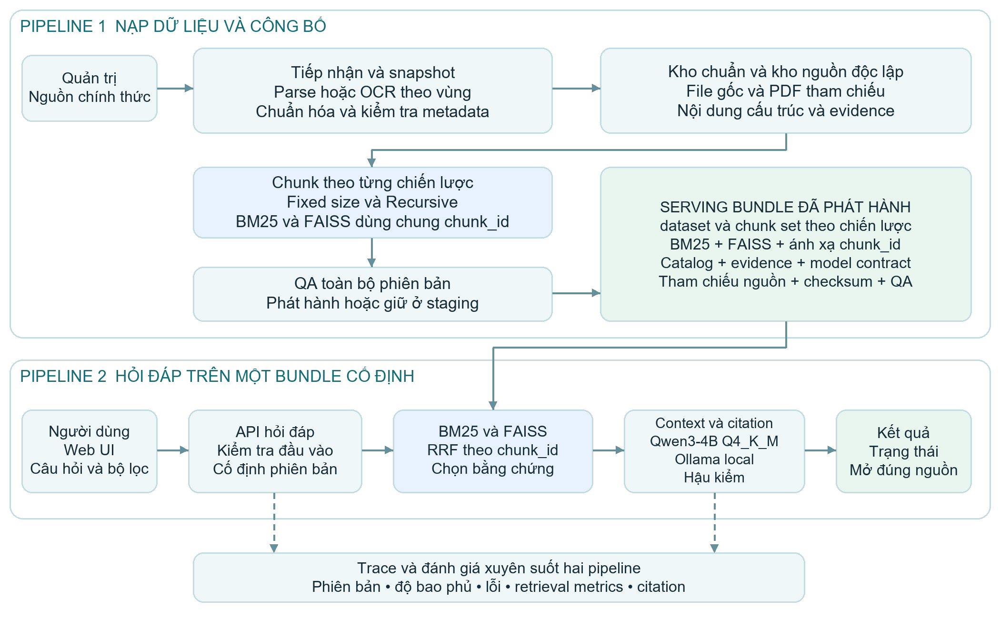
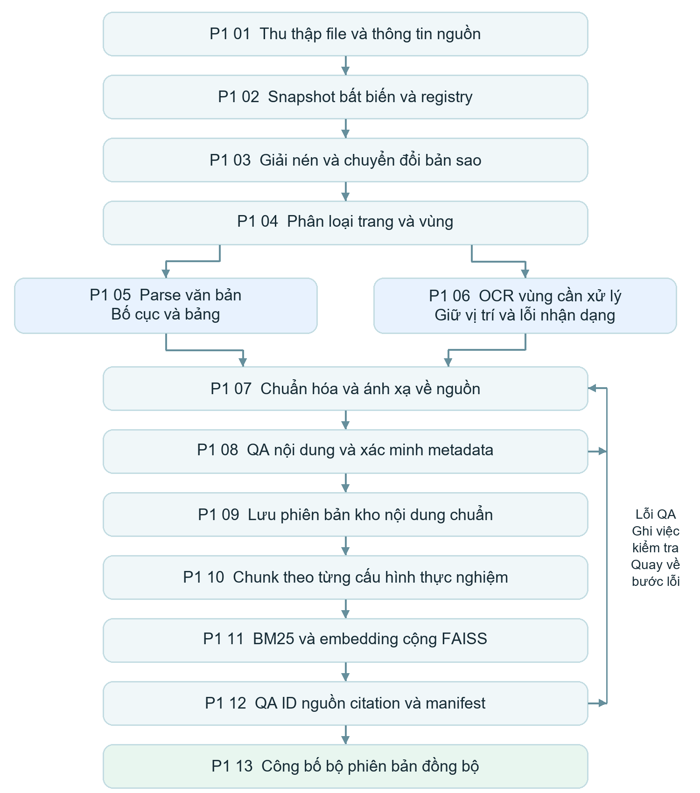
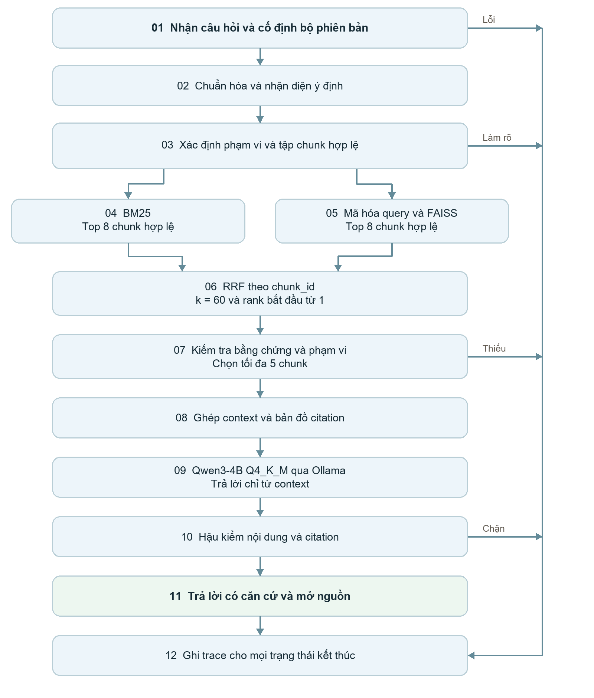
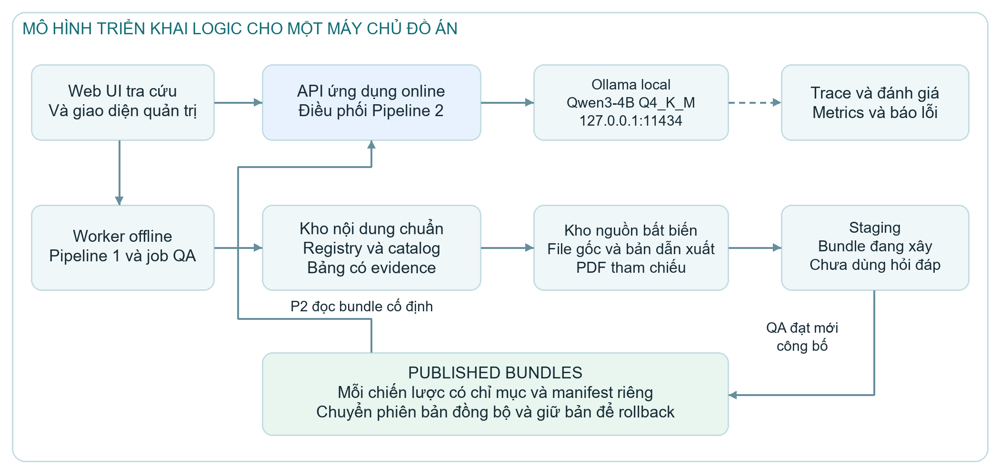

# Kiến trúc hệ thống tra cứu tài liệu đào tạo

Project 2 Cổng tra cứu văn bản nhà trường bằng Hybrid RAG

Phiên bản 1.1 | Ngày 08/11/2026

## Tóm tắt đề tài

Đề tài xây dựng cổng web cho phép sinh viên, giảng viên và cán bộ tra cứu tài liệu đào tạo của Trường Đại học Giao thông vận tải bằng từ khóa, số hoặc ký hiệu văn bản và câu hỏi tiếng Việt. Phạm vi gồm ngành và chuyên ngành, chuẩn đầu ra, chương trình đào tạo, học phần, quyết định và phụ lục liên quan. Kết quả cần chỉ rõ văn bản làm căn cứ, mục, trang và phạm vi chương trình áp dụng.

Hệ thống kết hợp hai pipeline. **Pipeline 1** xử lý nguồn, trích xuất và kiểm tra nội dung, tạo kho chuẩn, chia chunk theo hai chiến lược và phát hành chỉ mục. **Pipeline 2** nhận câu hỏi, truy xuất BM25 và FAISS trên cùng phạm vi, hợp nhất bằng RRF, chọn bằng chứng, tạo context cho LLM và kiểm tra câu trả lời trước khi trả nguồn cho người dùng.

Điểm kết nối là **gói phiên bản phục vụ** hay `serving_bundle`: tập kho, chunk, hai chỉ mục, metadata, cấu hình mô hình và bằng chứng nguồn được kiểm tra đồng bộ. Mỗi câu hỏi giữ một gói cố định trong toàn bộ quá trình. Hệ thống hỏi lại khi thiếu phạm vi và báo thiếu căn cứ khi nguồn chưa đủ; lỗi kỹ thuật được thông báo riêng.

LLM được chọn là **Qwen3-4B GGUF Q4_K_M chạy local qua Ollama**, không mất phí API. Các tham số là cấu hình thử nghiệm; chất lượng và tốc độ cần được đo trên dữ liệu dự án.

## 1 Kiến trúc hệ thống tổng thể

*Hình 1 Hai pipeline liên kết qua kho và gói phiên bản đã công bố*

<!-- page -->

## 2 Pipeline 1 Nạp dữ liệu và công bố chỉ mục

Pipeline 1 chạy theo tác vụ quản trị khi bổ sung hoặc cập nhật tài liệu. Nguồn PDF, DOC, DOCX và thành phần trong RAR được lưu nguyên bản; giải nén, chuyển đổi và OCR tạo sản phẩm dẫn xuất. Với Word, bản PDF tham chiếu cố định bố cục và ánh xạ trang phải đạt kiểm tra trước khi dùng citation theo trang.

| Bước | Đầu vào và xử lý | Đầu ra và kiểm tra |
|---|---|---|
| P1 01 Thu thập | Kiểm kê file, nguồn và phạm vi | Danh mục nguồn, trạng thái tiếp nhận và phần chưa truy cập được |
| P1 02 Snapshot | Lưu nguồn bất biến, SHA 256, đăng ký và nối file trùng byte | Registry và quan hệ nguồn, không ghi đè file cùng tên khác nội dung |
| P1 03 Chuyển đổi | Giải nén bản sao, đọc DOC/DOCX và tạo PDF tham chiếu | Dẫn xuất, danh sách trang và liên kết về nguồn |
| P1 04 Phân vùng | Phân loại trang có chữ tốt, ảnh hoặc hỗn hợp | Kế hoạch parse/OCR theo vùng, không bỏ trang ít chữ |
| P1 05 Parse | Đọc văn bản, bố cục, bảng và thứ tự đọc | Block, bảng, hàng/cột và vị trí nguồn |
| P1 06 Nhận dạng | OCR vùng cần xử lý, giữ ảnh và vị trí | Nội dung nhận dạng và vùng cần kiểm tra lại |
| P1 07 Chuẩn hóa | Hợp nhất hai nhánh, sửa lỗi có căn cứ | Raw/clean text, ánh xạ nguồn và nhật ký sửa |
| P1 08 Kiểm tra | Xác minh metadata, bảng và phạm vi đào tạo | Nội dung đủ điều kiện, cảnh báo và danh sách việc sửa lỗi |
| P1 09 Kho chuẩn | Lưu trang, section, bảng, chương trình, học phần và CĐR | `dataset_version`, evidence và mức bao phủ |
| P1 10 Chunking | Tạo bộ riêng theo Fixed size và Recursive | Chunk có ID, ngữ cảnh và toàn bộ span nguồn |
| P1 11 Lập chỉ mục | BM25 và embedding/FAISS trên cùng tập chunk | Hai chỉ mục, vector và ánh xạ ID đồng bộ |
| P1 12 Kiểm tra bộ | Kiểm tra checksum, tập ID, nguồn và manifest | Bộ đạt QA hoặc bị chặn, biên bản và giới hạn |
| P1 13 Công bố | Nạp kiểm chứng, chuyển phiên bản hiện hành và giữ bản cũ | Bundle được phát hành, lịch sử và cách quay lại |

Nhánh parse và OCR bổ trợ theo vùng, không bắt mọi trang chạy qua cả hai công cụ. Đối tượng lỗi được giữ để xử lý lại ở đúng bước. Có thể công bố tập con đạt yêu cầu, nhưng phải ghi phần chưa bao phủ và không mô tả bảng hoặc chương trình còn thiếu là đầy đủ.

<!-- page -->

## 3 Luồng dữ liệu và metadata dùng chung

*Hình 2 Kiểm tra chất lượng diễn ra trước khi kho và chỉ mục được sử dụng trực tuyến*

File vật lý, văn bản logic, phiên bản văn bản và phiên bản chương trình có định danh riêng. Một PDF có thể chứa nhiều ngành; metadata phải gắn đúng section, bảng hoặc chunk. Năm trong tên thư mục và ngày tiếp nhận không tự xác định năm ban hành, khóa áp dụng hay hiệu lực.

<!-- page -->

### Metadata và gói phiên bản

| Nhóm trường | Cấp quản lý | Mục đích |
|---|---|---|
| `file_id`, hash, nguồn và dẫn xuất | File | Giữ xuất xứ, snapshot và liên hệ với bản PDF tham chiếu |
| `logical_document_id`, `document_version_id` | Văn bản | Phân biệt một văn bản với các file chứa hoặc trích văn bản đó |
| Loại, trích yếu, số/ký hiệu, cơ quan, ngày | Văn bản hoặc phần văn bản | Nhận dạng văn bản và hỗ trợ exact match |
| Hiệu lực, thay thế, sửa đổi và trạng thái xác minh | Văn bản | Chỉ kết luận quan hệ hoặc phạm vi khi có bằng chứng |
| Ngành, chuyên ngành, bậc, loại chương trình và khóa | Section và chương trình | Lọc đúng đối tượng; không lan metadata sang toàn PDF tổng hợp |
| `program_version_id`, học kỳ, nhóm môn và quy tắc chọn | Chương trình và hàng bảng | Tra học phần/CĐR và kiểm tra điều kiện tính toán |
| `evidence_id`, file, trang, mục, vùng, hàng/ô | Bằng chứng | Truy ngược từng dữ kiện hoặc kết luận về nguồn |
| `chunk_id`, text, strategy và source spans | Chunk | Hai retriever hợp nhất đúng nội dung, giữ nguồn qua nhiều trang |
| Dataset, chunk set, index version và model contract | Bundle | Nạp và tái chạy một bộ cấu hình đồng nhất |

Mỗi giá trị metadata có trạng thái như `verified`, `unverified` hoặc `conflicting`. Trạng thái này khác trạng thái xử lý file và trạng thái phát hành bundle. Trường chưa biết để rỗng với lý do, không gán giá trị đoán để hoàn thiện bảng.

### Giao tiếp giữa hai pipeline

Bundle chứa manifest, catalog, `eligible_scope`, bộ chunk, BM25, FAISS, ánh xạ ID, hợp đồng embedding và các phụ thuộc nguồn/evidence. Bất biến bắt buộc là tập ID của BM25, FAISS và kho chunk bằng nhau trong cùng một chiến lược. Hai chiến lược có thể có số lượng và ID chunk khác nhau.

Khi nạp hoặc đổi bundle, dịch vụ kiểm tra checksum, schema, model revision, chiều vector và tham chiếu. Sau kiểm tra, con trỏ hiện hành được chuyển đồng bộ. Yêu cầu đang chạy tiếp tục dùng bundle cũ; nếu công bố thất bại, giữ bộ trước đó. Nguồn còn được citation hoặc yêu cầu tham chiếu phải tiếp tục tồn tại.

### Kho chuẩn và dữ liệu bảng

Kho nội dung chuẩn tồn tại độc lập với chỉ mục để có thể tái tạo chunk hoặc vector mà không mất dữ kiện gốc. Các bảng chương trình lưu quan hệ học phần, học kỳ, nhóm bắt buộc/tự chọn và CĐR kèm nguồn từng hàng. Nếu chưa kiểm tra đủ bảng hoặc quy tắc chọn, hệ thống không dùng bảng đó để khẳng định tổng tín chỉ của cả chương trình.

<!-- page -->

## 4 Pipeline 2 Hỏi đáp Hybrid RAG trực tuyến

*Hình 3 Truy xuất hai nhánh và kiểm tra bằng chứng trước khi trả lời*

<!-- page -->

### Chi tiết xử lý câu hỏi

1. **P2 01** nhận câu hỏi, bộ lọc và chiến lược; cố định bundle cho yêu cầu.
2. **P2 02** chuẩn hóa vừa đủ, giữ số/mã/ngày, nhận diện ý định và thực thể.
3. **P2 03** phân giải ngành, bậc, chương trình, phiên bản và tập chunk hợp lệ; hỏi lại khi mơ hồ ảnh hưởng đáp án.
4. **P2 04 và P2 05** truy xuất độc lập BM25 Top 8 và FAISS Top 8 trong cùng tập hợp lệ; query embedding tuân theo hợp đồng model của bundle.
5. **P2 06** hợp nhất theo `chunk_id` bằng RRF. **P2 07** kiểm tra phạm vi, nội dung và nguồn; chọn tối đa 5 chunk đủ liên quan.
6. **P2 08** tạo context theo ngân sách token và gắn anchor bằng chứng. **P2 09** gọi Qwen3-4B Q4_K_M qua Ollama local, chỉ trả lời từ context.
7. **P2 10** kiểm tra từng kết luận và citation, sửa tối đa một lần khi cần. **P2 11** trả kết quả cùng nguồn; **P2 12** ghi trace cho mọi trạng thái kết thúc.

### Hợp nhất bằng RRF

`RRF(c) = Σ 1 / (k_rrf + rank_r(c))` trên các nhánh có chunk c.

Cấu hình khởi đầu `k_rrf = 60`, rank bắt đầu từ 1, mỗi ID chỉ đóng góp một lần trong từng nhánh. Không cộng trực tiếp điểm BM25 với cosine hoặc distance vì chúng khác thang đo. RRF dùng để xếp hạng, không phải xác suất câu trả lời đúng. Chunk chỉ xuất hiện ở một nhánh vẫn có điểm hợp nhất.

### Exact match và lọc đúng phạm vi

Số/ký hiệu văn bản, mã ngành và mã học phần được tra qua catalog. Chỉ giới hạn cứng vào văn bản được người dùng chỉ định; câu so sánh cần giữ các nguồn ở cả hai phía. Metadata chưa xác minh không được dùng để khẳng định khóa áp dụng. Lọc FAISS phải thực hiện trên tập ID hợp lệ bằng cách phù hợp loại index; lấy Top 8 toàn cục rồi lọc một lần có thể bỏ mất kết quả đúng.

“Mới nhất trong kho” khác với “đang áp dụng”. Cần đối chiếu ngày, bậc/khóa và quan hệ thay thế/sửa đổi đã có bằng chứng. Không suy ra thay thế chỉ từ năm mới hơn hoặc tên thư mục.

### Kiểm tra câu trả lời và trạng thái

Citation phải chỉ đến bản PDF tham chiếu đã lưu, đúng mục và trang chứa nội dung hỗ trợ kết luận. URL gốc là thông tin xuất xứ bổ sung. Anchor tồn tại hoặc trang mở được chưa đủ chứng minh nội dung trả lời có căn cứ.

Kết quả có thể là `answered`, `partial`, `clarification_required`, `insufficient_evidence`, `retrieval_incomplete` hoặc `error`. Hết chỗ trong context có thể trả phần độc lập với lý do `context_budget`; `retrieval_incomplete` dành cho tìm kiếm bị dừng trước khi hoàn tất. Một nhánh bị lỗi không được ghi là Hybrid đã hoàn thành.

<!-- page -->

## 5 Các thành phần và triển khai hệ thống

| Thành phần | Trách nhiệm | Dữ liệu trao đổi chính |
|---|---|---|
| Giao diện người dùng | Hỏi đáp, lọc, xem đoạn và mở nguồn | Query, filters, answer và citation |
| API và điều phối | Kiểm tra yêu cầu, cố định bundle, điều phối P2 | Request, scope, version handle và response |
| Worker nạp dữ liệu | Chạy P1 theo job, quản lý lỗi và kiểm tra lại | Source inventory, normalized content và QA |
| Kho nội dung và catalog | Giữ nguồn, chương trình, bảng và evidence | Registry, record, scope và source spans |
| Quản lý phát hành | Kiểm tra, nạp và chuyển bundle, quay lại | Manifest, checksum, release history |
| Retrieval và LLM adapter | BM25/FAISS, RRF, context; gọi Ollama local và hậu kiểm | Candidate, evidence, context và draft |
| Nhật ký và đánh giá | Tái chạy, so sánh chunking và theo dõi lỗi | Trace, ground truth, metrics và biên bản |

*Hình 4 Tách tác vụ nạp khỏi phục vụ hỏi đáp trên cùng hạ tầng ban đầu*

Bản đầu chạy trên một máy với API ứng dụng, worker nạp và Ollama tách tiến trình. Ollama phục vụ Qwen3-4B Q4_K_M tại 127.0.0.1:11434. File nguồn, staging và bundle được lưu riêng. Embedding chạy local, ưu tiên CPU để dành VRAM cho LLM; cấu hình được khóa theo từng thí nghiệm.

Quyền tra cứu tách khỏi quyền nạp, sửa metadata, công bố và rollback. API nguồn nhận `file_id`, phiên bản và trang hợp lệ; không cho client hoặc LLM chỉ định đường dẫn tùy ý. API Ollama là giao tiếp nội bộ trên máy, không yêu cầu dịch vụ trả phí. Chạy suy luận offline sau khi tải đủ model và phụ thuộc; tắt tính năng cloud của Ollama.

<!-- page -->

### LLM local được chọn

Hệ thống dùng **Qwen3-4B GGUF, lượng tử hóa Q4_K_M**, từ kho chính chủ `Qwen/Qwen3-4B-GGUF`. Mô hình thuộc dòng Qwen3 hỗ trợ tiếng Việt và được phát hành theo Apache 2.0. Ollama chạy suy luận trên máy; sau khi tải đủ tài nguyên, baseline không dùng cloud, không cần API key trả phí và không bị tính tiền theo token. Đây là lựa chọn triển khai cho đồ án, chưa phải kết quả benchmark trên corpus UTC.

| Nội dung | Cấu hình khởi đầu |
|---|---|
| Model và runtime | Qwen3-4B Q4_K_M qua Ollama local |
| Vai trò | Đọc bằng chứng và sinh bản nháp tại P2 09; hậu kiểm vẫn do P2 10 thực hiện |
| Giao tiếp | Backend gọi `POST http://127.0.0.1:11434/api/chat`; người dùng chỉ truy cập API ứng dụng |
| Chế độ sinh | Non-thinking; tối đa 512 token đầu ra; một yêu cầu sinh mỗi lượt |
| Ngân sách | `num_ctx=4096`; bằng chứng mục tiêu 2.000, tối đa 2.500 token khi còn đủ chỗ |
| Kiểm soát local | Tắt cloud bằng `OLLAMA_NO_CLOUD=1`; không tự chuyển sang model cloud khi lỗi |
| Khóa thực nghiệm | Ghi GGUF hash/digest, quantization, Ollama version, prompt và cấu hình sinh |

Tổng token của template, system prompt, câu hỏi, phạm vi, lịch sử, bằng chứng, 512 token đầu ra và 128 token dự phòng phải nằm trong 4.096. Vì vậy Top 5 là số ứng viên tối đa, không phải cam kết luôn ghép đủ 5 chunk. Nếu ngân sách thiếu, chọn phần độc lập có căn cứ và trả `partial` khi phù hợp.

Máy thử nghiệm có RTX 3050 Ti Laptop 4 GB VRAM. Dung lượng weights không bao gồm KV cache và bộ nhớ runtime; cần đo khi chạy. Khởi đầu một yêu cầu mỗi lượt, ưu tiên embedding trên CPU và tránh chạy OCR GPU đồng thời. Nếu không đủ VRAM, giảm ngân sách hoặc dùng CPU/GPU kết hợp với cấu hình được ghi riêng; không tự đổi model khi đang so sánh chunking.

Embedding tạo vector cho FAISS và LLM sinh câu trả lời là hai thành phần riêng. Đổi LLM không tự buộc xây lại BM25/FAISS, nhưng phải tạo cấu hình sinh mới và làm mất hiệu lực cache câu trả lời liên quan. Phần mềm phải kiểm tra JSON, anchor và nội dung nguồn dù model đã trả được JSON hợp lệ.

Nguồn kỹ thuật: https://huggingface.co/Qwen/Qwen3-4B-GGUF ; https://docs.ollama.com/api/chat ; https://docs.ollama.com/faq

<!-- page -->

## 6 Cấu hình thực nghiệm và đánh giá

| Nội dung | Cấu hình và yêu cầu khởi đầu |
|---|---|
| Hai chiến lược chunking | Fixed size và Recursive trên cùng dataset và phạm vi |
| Retrieval | BM25 Top 8 và FAISS Top 8, RRF với hằng số 60 |
| Context | Tối đa 5 chunk; mục tiêu 2.000 token bằng chứng, trần 2.500 khi tổng ngân sách cho phép |
| Embedding | Model/tokenizer/metric theo manifest; không thay độc lập ở online |
| LLM | Qwen3-4B GGUF Q4_K_M qua Ollama local; non-thinking, tổng context 4.096 token, đầu ra tối đa 512 token |
| Mở rộng | Kho bảng, reranker hoặc truy vấn con được bật và đánh giá riêng |

Theo đề bài, tập kiểm thử gồm ít nhất 15 câu hỏi, chia đều khớp từ khóa, diễn đạt lại theo ngữ nghĩa và tổng hợp nhiều thông tin. Mỗi câu có nguồn, trang, mục hoặc span bằng chứng chuẩn. Câu ngoài corpus và câu cần làm rõ được bổ sung thành tập chẩn đoán riêng.

Báo cáo Precision@3 và Recall@3 trên tập chunk liên quan được ánh xạ cho từng chiến lược; bổ sung EvidenceCoverage@3 để đo bao phủ cùng tập bằng chứng gốc và tránh đếm lặp do overlap. Đánh giá câu trả lời về tính đúng, đầy đủ, bám nguồn, đúng phạm vi và citation; đo thêm thời gian và token. Phân tích ca tốt, ca thất bại và ca hai chiến lược cho kết quả khác nhau. Ngưỡng chất lượng được chọn trước lần nghiệm thu, không trình bày con số chưa đo như kết quả đã đạt.

### Điều kiện bàn giao

- Nguồn và dữ kiện phục vụ truy ngược được; không còn ID mồ côi hoặc cặp chỉ mục lệch tập chunk trong bundle phát hành.
- Pipeline 1 có manifest, báo cáo QA, phạm vi bao phủ và thao tác công bố/quay lại đã kiểm chứng.
- Pipeline 2 thể hiện đủ nhánh trả lời, làm rõ, thiếu căn cứ, truy xuất chưa hoàn tất và lỗi; citation mở đúng bản nguồn.
- Hai chiến lược được đánh giá với điều kiện so sánh nhất quán; có mã nguồn, cấu hình, README và hồ sơ tái chạy.

## 7 Tài liệu đối chiếu

Tài liệu mẫu `Pipeline_Cong_tra_cuu_van_ban_nha_truong.docx` cung cấp cấu trúc báo cáo, kiến trúc hai pipeline và luồng Hybrid RAG. `Project_ChuyenDeCNTT.pdf`, trang 3–4 và 6–7, quy định metadata, retrieval, đánh giá và chức năng Project 2.

Hai nguồn đặc tả được tích hợp là `Dac_ta_Pipeline_1_xu_ly_va_lap_kho_du_lieu.md` ngày 06/11/2026 và `Pipeline_2_Hoi_dap_Hybrid_RAG.md` ngày 08/11/2026. Bản đặc tả toàn hệ thống đi kèm cụ thể hóa chức năng, hợp đồng dữ liệu, giao diện dịch vụ, vận hành và tiêu chí kiểm tra.
